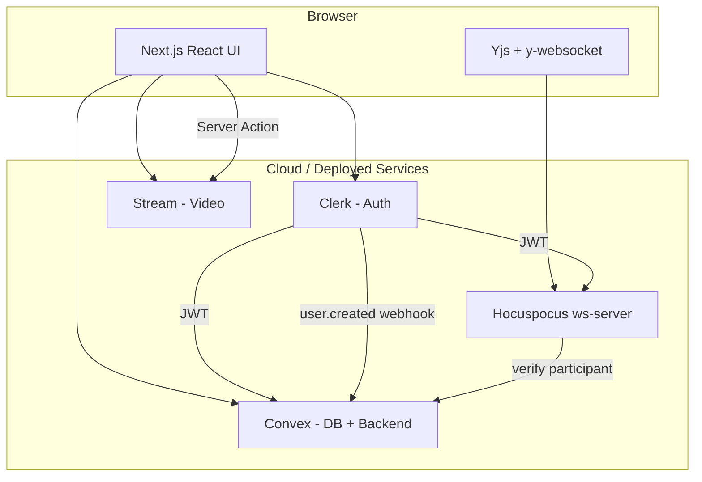
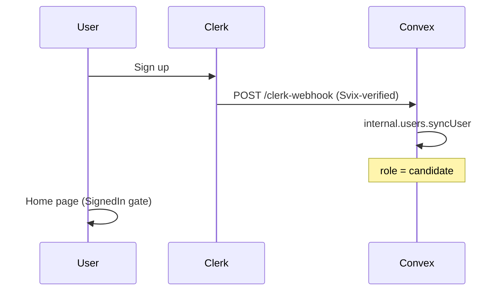
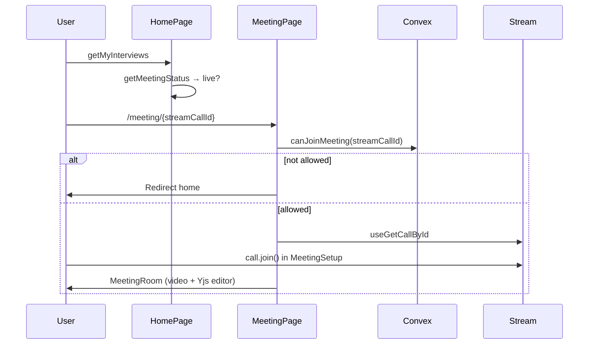
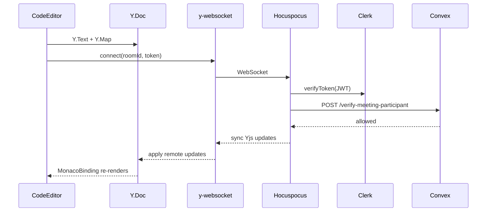

# CodeSync — Complete Interview Preparation Guide

> **Purpose:** Understand your remote interview platform inside-out for campus placement interviews at FAANG, Couchbase, Meesho, PayPal, PhonePe, and similar firms.
>
> **How to use:** Read Parts 1–3 for the big picture. Study Parts 4–8 for technical depth. Practice Part 10 out loud. Keep Part 11 open on interview day.
>
> **Last updated:** Reflects the current codebase including Yjs collaborative editing, auth hardening, meeting access control, and dashboard role promotion.

---

## Table of Contents

1. [Introduction & Elevator Pitch](#part-1--introduction--elevator-pitch)
2. [Tech Stack & Glossary](#part-2--tech-stack--glossary)
3. [Application Flow & User Journeys](#part-3--application-flow--user-journeys)
4. [Frontend Deep Dive](#part-4--frontend-deep-dive)
5. [Backend Deep Dive (Convex)](#part-5--backend-deep-dive-convex)
6. [Collaborative Editor & WebSocket Server](#part-6--collaborative-editor--websocket-server)
7. [Database Design](#part-7--database-design)
8. [Third-Party APIs & Security Model](#part-8--third-party-apis--security-model)
9. [Environment Setup & Deployment](#part-9--environment-setup--deployment)
10. [Interview Questions (80+)](#part-10--interview-questions-80)
11. [Quick Reference Cheat Sheet](#part-11--quick-reference-cheat-sheet)

---

# Part 1 — Introduction & Elevator Pitch

## What Is CodeSync?

**CodeSync** (package name: `codesync`) is a **remote technical interview platform** — a simplified Zoom + LeetCode in one web app.

**The problem it solves:** Remote hiring needs video, live collaborative coding, scheduling, and post-interview evaluation in one place.

**What the app does:**
1. **Interviewers** schedule interviews, review candidates on a dashboard, and promote teammates to interviewer role
2. **Candidates** see upcoming interviews and join during the live window
3. During an interview: **split-screen room** — video (35%) + collaborative Monaco editor (65%)
4. After the interview: interviewers **pass/fail** and leave rated comments

## Architecture in One Sentence

> CodeSync is a **Next.js 14** app using **Clerk** for auth, **Convex** for real-time data, **Stream** for video, and a **Hocuspocus WebSocket server** for Yjs collaborative code editing — with a dedicated `ws-server/` process (not Express for the main API).



## 30-Second Elevator Pitch

> "I built CodeSync, a remote technical interview platform using Next.js, TypeScript, Convex, Clerk, Stream Video, and Yjs. Interviewers schedule video interviews, conduct **live collaborative coding** in a split-screen room with Monaco + real-time sync, and evaluate candidates on a dashboard. Convex handles real-time data, Clerk handles auth, Stream powers WebRTC video, and a Hocuspocus WebSocket server syncs the code editor with participant-verified room access."

## 2-Minute Detailed Pitch

> "CodeSync solves remote technical hiring. The stack is Next.js 14 App Router, Convex as BaaS, Clerk for authentication, Stream Video SDK for WebRTC calls, and a Hocuspocus WebSocket server for collaborative editing via Yjs CRDTs.
>
> On signup, Clerk fires a webhook to Convex which creates a user with role `candidate`. Existing interviewers promote teammates from the **dashboard Team section** via `promoteToInterviewer`. Scheduling creates a Stream call first, then a Convex record linked by `streamCallId`.
>
> Before joining, `canJoinMeeting` verifies the user is the assigned candidate or an interviewer. The meeting room has video + a **collaborative Monaco editor** — room ID equals the Stream call ID, WS auth verifies Clerk JWT plus Convex participant membership.
>
> After the call, the owner ends it → `updateInterviewStatus('completed')` with auth checks. Dashboard pass/fail uses role-guarded mutations. Defense in depth: Clerk middleware on `/dashboard` and `/schedule`, admin layout guard, Convex role checks on every sensitive query/mutation."

## Your Role Framing

| Area | What you implemented |
|------|---------------------|
| **Full-stack ownership** | Frontend UI + Convex backend + ws-server + integrations |
| **Auth flow** | Clerk sign-in, JWT bridge to Convex, webhook user sync, shared auth helpers |
| **Real-time data** | Convex `useQuery` subscriptions for interviews and dashboard |
| **Real-time code sync** | Yjs + y-monaco + Hocuspocus with participant verification |
| **Video integration** | Stream client, Server Action token generation, meeting room UI |
| **Security hardening** | Middleware, route guards, `canJoinMeeting`, mutation auth |
| **Interview lifecycle** | Schedule → join → conduct → end → evaluate |
| **Role management** | Dashboard promotion UI + `promoteToInterviewer` mutation |

## Strengths to Highlight Proactively

| Strength | What to say |
|----------|-------------|
| **Collaborative editor** | "Yjs CRDTs over Hocuspocus. Room = `streamCallId`. WS auth: Clerk JWT + Convex participant check via HTTP." |
| **Defense in depth** | "Clerk middleware → layout guards → Convex `requireInterviewer` / `requireInterviewParticipant` on mutations." |
| **Meeting access control** | "`canJoinMeeting` blocks unauthorized users before `call.join()`." |
| **Status mutation rules** | "`completed` = any participant; `succeeded`/`failed` = interviewer on that interview only." |
| **Admin panel** | "Interviewers promote candidates from dashboard — no manual DB edits." |
| **Server-side secrets** | "Stream tokens via Server Action; `syncUser` is `internalMutation` (webhook only)." |

## Honest Limitations (Say These Proactively)

| Limitation | What to say |
|------------|-------------|
| **Instant meetings broken** | "New Call creates a Stream session only — no Convex record. `canJoinMeeting` returns `not_found` and redirects home. Fix: create a Convex record or a separate instant-meeting auth path." |
| **No code execution** | "Editor syncs in real time but doesn't run code. Next step: Judge0/Piston sandbox." |
| **Single WS server** | "Hocuspocus is in-memory, single instance. Production needs Redis pub/sub for horizontal scaling." |
| **Remaining auth gaps** | "`getComments` has no auth. `addComment` checks login only, not interviewer role. `getUserByClerkId` is public — any signed-in user can look up roles." |
| **First interviewer bootstrap** | "Someone must be interviewer initially — one-time Convex dashboard edit, then use dashboard to promote others." |
| **`live` status is client-only** | "Join window is computed in `getMeetingStatus()` — not enforced server-side for join (only participant check is)." |
| **No automated tests** | "Manual testing only. Would add Convex integration tests and Playwright E2E." |
| **Orphan Stream calls** | "If `createInterview` fails after Stream `getOrCreate`, Stream call exists without Convex row." |

---

# Part 2 — Tech Stack & Glossary

## Tech Stack Overview

| Layer | Technology | Version | Role in CodeSync |
|-------|-----------|---------|------------------|
| **Framework** | Next.js (App Router) | 14.2 | Routing, Server Actions, React |
| **Language** | TypeScript | 5.x | Frontend + Convex type safety |
| **UI** | React + shadcn/ui (Radix) | 18.x | Components |
| **Styling** | Tailwind CSS | 3.4 | Utility-first CSS |
| **Auth** | Clerk | 6.9 | Login, JWTs, webhooks |
| **Backend + DB** | Convex | 1.18 | Queries, mutations, HTTP routes, real-time |
| **Video** | Stream Video SDK | 1.10 | WebRTC, screen share, recordings |
| **Code editor** | Monaco (`@monaco-editor/react`) | 4.6 | VS Code engine in browser |
| **Collaboration** | Yjs + y-monaco + y-websocket | — | CRDT sync to Monaco |
| **WS server** | Hocuspocus (`@hocuspocus/server`) | 2.15 | y-websocket protocol server |
| **Layout** | react-resizable-panels | 2.1 | Video/code split |
| **Webhooks** | Svix | — | Clerk signature verification |
| **Dates** | date-fns | 3.6 | Formatting, `getMeetingStatus` |
| **Toasts** | react-hot-toast | — | User feedback |
| **Theming** | next-themes | — | Dark/light mode |

## Key Glossary Additions

| Term | Definition |
|------|------------|
| **Yjs** | CRDT library — conflict-free replicated data types for collaborative editing |
| **CRDT** | Data structure where concurrent edits merge without conflicts |
| **Hocuspocus** | WebSocket server implementing y-websocket protocol; handles Yjs doc sync |
| **y-monaco** | Binds a Yjs `Y.Text` to a Monaco editor model |
| **internalMutation** | Convex function callable only from other Convex functions (not browser) |
| **streamCallId** | UUID linking Convex interview ↔ Stream call ↔ Yjs room name |

## Why This Stack?

| Choice | Alternative | Why CodeSync uses it |
|--------|------------|---------------------|
| Convex | Express + PostgreSQL | Real-time `useQuery`, no REST boilerplate |
| Clerk | NextAuth | Hosted UI, JWT, webhooks out of the box |
| Stream | Raw WebRTC | Pre-built React video components |
| Yjs + Hocuspocus | Liveblocks, Convex transport | Full control, low-latency keystroke sync |
| Next.js | Vite SPA | Server Actions for Stream secrets, App Router |

---

# Part 3 — Application Flow & User Journeys

## User Roles

| Role | How assigned | Capabilities |
|------|-------------|--------------|
| **Candidate** | Default on signup (`syncUser` webhook) | View own interviews, join live meetings |
| **Interviewer** | `promoteToInterviewer` from dashboard (or one-time DB bootstrap) | Schedule, dashboard, pass/fail, promote users |

## Interview Status Lifecycle

```
upcoming (DB) → live (client-computed) → completed (DB) → succeeded | failed (DB)
```

| Status | Stored in DB? | Set by |
|--------|--------------|--------|
| `upcoming` | Yes | `createInterview` |
| `live` | **No** — computed | `getMeetingStatus()` in `src/lib/utils.ts` |
| `completed` | Yes | `EndCallButton` → `updateInterviewStatus` |
| `succeeded` / `failed` | Yes | Dashboard → `updateInterviewStatus` |

**`getMeetingStatus` logic** (`src/lib/utils.ts:79-93`):
- Terminal statuses (`completed`, `succeeded`, `failed`) → return `"completed"` (UI: no join)
- Now within 1 hour after `startTime` → `"live"`
- Before start → `"upcoming"`
- After window → `"completed"`

**Mutation allowed statuses** (`convex/interviews.ts:10`): only `completed`, `succeeded`, `failed`.

---

## Journey A — User Sign Up



**Files:** `src/app/layout.tsx`, `convex/http.ts`, `convex/users.ts`

**`syncUser`** is an **`internalMutation`** — not callable from the browser. Only the webhook invokes it.

---

## Journey B — Schedule Interview (Interviewer)

1. Navigate to `/schedule` — protected by **middleware** + **page-level** interviewer check
2. Fill form: title, description, date, time, candidate, co-interviewers
3. `crypto.randomUUID()` → Stream `client.call("default", id).getOrCreate()`
4. `createInterview({ ..., status: "upcoming", streamCallId, candidateId, interviewerIds })`
5. `createInterview` requires: `requireInterviewer` + caller in `interviewerIds`

**Files:** `InterviewScheduleUI.tsx`, `convex/interviews.ts`

---

## Journey C — Candidate Joins Interview



**Access control layers:**
1. `canJoinMeeting` query — auth + participant check
2. `MeetingPage` redirects if `!allowed`
3. `MeetingSetup` disables Join button if `!allowed`
4. WS server re-verifies on editor connect

**Files:** `meeting/[id]/page.tsx`, `MeetingSetup.tsx`, `MeetingRoom.tsx`

---

## Journey D — Instant Meeting (Known Bug)

1. Interviewer clicks "New Call" → `useMeetingActions.createInstantMeeting()`
2. Creates Stream call only — **no Convex record**
3. Redirects to `/meeting/{uuid}`
4. `canJoinMeeting` → `{ allowed: false, reason: "not_found" }`
5. **User is redirected home — instant meetings do not work with current access control**

**Fix options:** Create minimal Convex record for instant calls, or bypass `canJoinMeeting` for Stream-only calls with alternate auth.

---

## Journey E — Collaborative Editing During Meeting

1. `MeetingRoom` passes `call.id` to `<CodeEditor roomId={call.id} />`
2. `useCollaborativeEditor` creates `Y.Doc`, connects `WebsocketProvider` to `NEXT_PUBLIC_WS_URL`
3. Clerk JWT sent as `params.token`
4. Hocuspocus `onAuthenticate` → verify JWT → POST to Convex `/verify-meeting-participant`
5. `MonacoBinding` syncs `Y.Text("monaco")` across peers
6. Question/language changes update shared `Y.Map("meta")`

---

## Journey F — End Call & Evaluate

1. **End Meeting** visible only if `localParticipant.userId === call.state.createdBy.id`
2. `call.endCall()` + `updateInterviewStatus({ status: "completed" })` — requires participant auth
3. Dashboard: Pass/Fail → `updateInterviewStatus("succeeded"|"failed")` — requires interviewer on that interview
4. `CommentDialog` → `addComment({ interviewId, content, rating })`

---

# Part 4 — Frontend Deep Dive

## Project Structure

```
src/
├── actions/stream.actions.ts          # Server Action: Stream token
├── app/
│   ├── layout.tsx                     # Root: ConvexClerkProvider, SignedIn gate
│   ├── middleware.ts                  # (at src/middleware.ts)
│   ├── (root)/
│   │   ├── layout.tsx                 # StreamClientProvider
│   │   ├── (home)/page.tsx            # /
│   │   ├── meeting/[id]/page.tsx      # /meeting/:id
│   │   ├── schedule/                  # /schedule
│   │   └── recordings/page.tsx        # /recordings
│   └── (admin)/
│       ├── layout.tsx                 # Interviewer guard
│       └── dashboard/page.tsx         # /dashboard
├── components/
│   ├── CodeEditor.tsx                 # Collaborative Monaco
│   ├── MeetingRoom.tsx
│   ├── MeetingSetup.tsx
│   ├── EndCallButton.tsx
│   └── providers/
├── hooks/
│   ├── useCollaborativeEditor.ts      # Yjs + Monaco binding
│   ├── useUserRole.ts
│   ├── useMeetingActions.ts
│   ├── useGetCallById.ts
│   └── useGetCalls.ts
├── constants/index.ts                 # Questions, time slots
└── lib/utils.ts

ws-server/
├── index.js                           # Hocuspocus server
└── package.json

convex/
├── lib/auth.ts                        # Shared auth helpers
├── schema.ts
├── users.ts, interviews.ts, comments.ts
├── http.ts                            # Webhooks + WS verification
└── auth.config.ts
```

## Routing & Access Control

| URL | File | Access |
|-----|------|--------|
| `/` | `(home)/page.tsx` | Signed-in (layout gate) |
| `/schedule` | `schedule/page.tsx` | Middleware + interviewer (page + would use layout if under admin — it's under root with own guard) |
| `/recordings` | `recordings/page.tsx` | Signed-in |
| `/meeting/[id]` | `meeting/[id]/page.tsx` | Signed-in + `canJoinMeeting` |
| `/dashboard` | `dashboard/page.tsx` | Middleware + `(admin)/layout.tsx` interviewer guard |

## Middleware (`src/middleware.ts`)

```typescript
const isProtectedRoute = createRouteMatcher(["/dashboard(.*)", "/schedule(.*)"]);

export default clerkMiddleware(async (auth, req) => {
  if (isProtectedRoute(req)) await auth.protect();
});
```

**What it does:** Forces sign-in for `/dashboard` and `/schedule` at the Edge.

**What it cannot do:** Check Convex roles (no Convex client on Edge). Role checks happen in layout + Convex functions.

## Admin Layout (`src/app/(admin)/layout.tsx`)

Client-side guard: `useUserRole()` → if not interviewer, `router.push("/")`.

## Custom Hooks

| Hook | File | Purpose |
|------|------|---------|
| `useCollaborativeEditor` | `useCollaborativeEditor.ts` | Yjs doc, WS provider, Monaco binding, shared question/language |
| `useUserRole` | `useUserRole.ts` | `isInterviewer`, `isCandidate`, `isLoading` via `getUserByClerkId` |
| `useMeetingActions` | `useMeetingActions.ts` | `createInstantMeeting()`, `joinMeeting(callId)` |
| `useGetCallById` | `useGetCallById.ts` | Stream `queryCalls` by ID |
| `useGetCalls` | `useGetCalls.ts` | Calls for recordings page |

### useCollaborativeEditor — Key behavior

- **Room ID** = Stream `call.id` = Convex `streamCallId`
- **Y.Text** `"monaco"` — shared code
- **Y.Map** `"meta"` — keys `questionId`, `language`
- **First sync:** if doc empty, inserts starter code + default meta
- **Cleanup:** destroys binding, provider, doc on unmount
- **Env:** `NEXT_PUBLIC_WS_URL` (default `ws://localhost:1234`)

## Key Components

### MeetingRoom (`MeetingRoom.tsx`)

```
┌─────────────────────────────────────────────────────┐
│  Video (35%)          │  CodeEditor (65%)           │
│  SpeakerLayout        │  Question panel (top)       │
│  CallControls         │  Monaco + Yjs (bottom)      │
│  EndCallButton        │                             │
└─────────────────────────────────────────────────────┘
```

### CodeEditor (`CodeEditor.tsx`)

- **Collaborative** via `useCollaborativeEditor(roomId)`
- 3 questions, 3 languages from `constants/index.ts`
- Loading overlay until `isSynced`
- Monaco uses `onMount` + `bindEditor` — **not** controlled `value`/`onChange`

### MeetingSetup (`MeetingSetup.tsx`)

- `useQuery(api.interviews.canJoinMeeting, { streamCallId: call.id })`
- Join button disabled if `!allowed`
- Error message for `not_found` vs `not_participant`

### EndCallButton (`EndCallButton.tsx`)

- Uses `getInterviewByStreamCallId` (auth + participant required)
- Only meeting owner sees button
- `updateInterviewStatus("completed")` — participant auth on server

### Dashboard (`dashboard/page.tsx`)

- Interviews grouped by `groupInterviews()` + `INTERVIEW_CATEGORY`
- Pass/Fail for `status === "completed"`
- **Team section:** list users, Promote to Interviewer for candidates

## Server Action — Stream Token (`stream.actions.ts`)

```typescript
"use server";
export const streamTokenProvider = async () => {
  const user = await currentUser();
  if (!user) throw new Error("User not authenticated");
  const streamClient = new StreamClient(
    process.env.NEXT_PUBLIC_STREAM_API_KEY!,
    process.env.STREAM_SECRET_KEY!
  );
  return streamClient.generateUserToken({ user_id: user.id });
};
```

`STREAM_SECRET_KEY` never reaches the browser.

---

# Part 5 — Backend Deep Dive (Convex)

## Convex File Structure

```
convex/
├── lib/auth.ts              # requireAuth, requireInterviewer, etc.
├── schema.ts
├── auth.config.ts           # Clerk JWT provider
├── users.ts
├── interviews.ts
├── comments.ts
└── http.ts                  # /clerk-webhook, /verify-meeting-participant
```

## Auth Helpers (`convex/lib/auth.ts`)

| Function | Behavior |
|----------|----------|
| `requireAuth(ctx)` | `getUserIdentity()` or throw `"Unauthorized"` |
| `getCurrentUser(ctx)` | Auth + load user by `clerkId` |
| `requireInterviewer(ctx)` | User must have `role === "interviewer"` |
| `isInterviewParticipant(clerkId, interview)` | `candidateId` or in `interviewerIds` |
| `requireInterviewParticipant(ctx, interview)` | Auth + participant check |

## Complete Convex API Reference

### users.ts

| Function | Type | Auth | Args | Notes |
|----------|------|------|------|-------|
| `syncUser` | **internalMutation** | Internal only | name, email, clerkId, image? | Webhook only; role=`candidate` |
| `getUsers` | query | `requireInterviewer` | none | All users |
| `getUserByClerkId` | query | **None** | clerkId | Used by `useUserRole` |
| `promoteToInterviewer` | mutation | `requireInterviewer` | targetClerkId | Patches role to interviewer |

### interviews.ts

| Function | Type | Auth | Args | Notes |
|----------|------|------|------|-------|
| `getAllInterviews` | query | `requireInterviewer` | none | |
| `getMyInterviews` | query | Optional | none | Returns `[]` if unauthenticated |
| `getInterviewByStreamCallIdInternal` | **internalQuery** | Internal | streamCallId | WS verification |
| `getInterviewByStreamCallId` | query | Auth + participant | streamCallId | Throws if not participant |
| `canJoinMeeting` | query | `requireAuth` | streamCallId | Returns `{ allowed, reason?, interview? }` |
| `createInterview` | mutation | Interviewer + in interviewerIds | title, startTime, streamCallId, etc. | |
| `updateInterviewStatus` | mutation | See rules below | id, status | |

**`updateInterviewStatus` rules:**
- Status must be `completed`, `succeeded`, or `failed`
- `completed` → `requireInterviewParticipant`
- `succeeded` / `failed` → `requireInterviewer` + caller in `interviewerIds`

### comments.ts

| Function | Type | Auth | Args | Gap |
|----------|------|------|------|-----|
| `addComment` | mutation | Login only | interviewId, content, rating | No interviewer/participant check |
| `getComments` | query | **None** | interviewId | Public read |

### HTTP routes (`convex/http.ts`)

| Path | Method | Auth | Purpose |
|------|--------|------|---------|
| `/clerk-webhook` | POST | Svix signature | `user.created` → `internal.users.syncUser` |
| `/verify-meeting-participant` | POST | `Bearer ${WS_SERVER_SECRET}` | WS server participant check |

## Real-Time Pattern

```tsx
const interviews = useQuery(api.interviews.getAllInterviews);
const promote = useMutation(api.users.promoteToInterviewer);
```

`useQuery` subscribes via Convex WebSocket — all clients update when data changes.

---

# Part 6 — Collaborative Editor & WebSocket Server

## Architecture



## Client (`useCollaborativeEditor.ts`)

```typescript
provider = new WebsocketProvider(wsUrl, roomId, ydoc, {
  connect: true,
  params: { token: await getToken() },
});
bindingRef.current = new MonacoBinding(ytext, model, editors, awareness);
```

## Server (`ws-server/index.js`)

- **Port:** `PORT` env (default 1234)
- **Protocol:** y-websocket (Hocuspocus compatible)
- **Room name:** `documentName` = `streamCallId`
- **Auth flow:**
  1. `onAuthenticate({ token, documentName })`
  2. `verifyToken(token, { secretKey: CLERK_SECRET_KEY })` → `clerkId = sub`
  3. `fetch(CONVEX_SITE_URL/verify-meeting-participant)` with `WS_SERVER_SECRET`
  4. Reject if `!allowed`

## Run locally

```bash
# Terminal 1
npm run dev

# Terminal 2
cd ws-server && npm install && npm run dev

# Terminal 3
npx convex dev
```

---

# Part 7 — Database Design

## Schema (`convex/schema.ts`)

### users
| Field | Type | Notes |
|-------|------|-------|
| name, email | string | From Clerk |
| image | string? | Profile URL |
| role | `"candidate"` \| `"interviewer"` | |
| clerkId | string | Index: `by_clerk_id` |

### interviews
| Field | Type | Notes |
|-------|------|-------|
| title, description? | string | |
| startTime, endTime? | number | Unix ms |
| status | string | upcoming / completed / succeeded / failed |
| streamCallId | string | = Stream call ID = Yjs room |
| candidateId | string | Clerk user ID |
| interviewerIds | string[] | Clerk user IDs |

Indexes: `by_candidate_id`, `by_stream_call_id`

### comments
| Field | Type |
|-------|------|
| content, rating | string, number |
| interviewerId | Clerk ID |
| interviewId | `Id<"interviews">` |

## ID Conventions

| ID | Example | Used for |
|----|---------|----------|
| Convex `_id` | `j57abc...` | Interview/comment documents |
| Clerk ID | `user_2abc...` | candidateId, interviewerIds, identity.subject |
| Stream call ID | UUID | URL, streamCallId, Yjs room |

---

# Part 8 — Third-Party APIs & Security Model

## Security Layers (Defense in Depth)

| Layer | Mechanism | Scope |
|-------|-----------|-------|
| 1 | Root layout `SignedIn` / `RedirectToSignIn` | All pages |
| 2 | Clerk middleware `auth.protect()` | `/dashboard`, `/schedule` |
| 3 | `(admin)/layout.tsx` interviewer guard | `/dashboard` |
| 4 | `schedule/page.tsx` interviewer guard | `/schedule` |
| 5 | `canJoinMeeting` | `/meeting/[id]` |
| 6 | Convex auth helpers | Queries/mutations |
| 7 | Hocuspocus + Convex HTTP | Yjs rooms |
| 8 | Svix webhook verification | User creation |
| 9 | `WS_SERVER_SECRET` bearer | Participant HTTP endpoint |

## What's Protected (Server-Enforced)

- `getAllInterviews`, `getUsers`, `createInterview`, `promoteToInterviewer`
- `updateInterviewStatus` with role/participant rules
- `getInterviewByStreamCallId`, `canJoinMeeting`
- `syncUser` (internal only)
- Stream secret (Server Action only)
- WS rooms (JWT + participant)

## Remaining Gaps (Be Honest in Interviews)

| Gap | Risk | Fix |
|-----|------|-----|
| `getComments` no auth | Read comments if you know interviewId | Add `requireInterviewer` |
| `addComment` login only | Any user could comment | Require interviewer + assignment |
| `getUserByClerkId` public | Role lookup by clerkId | Require auth or self-only |
| Instant meetings | Feature broken | Create Convex record or alternate auth |
| Client-only `live` window | Join outside window if participant | Server-side time check in `canJoinMeeting` |
| First interviewer | Bootstrap problem | Seed script or env-based admin |

## Clerk Integration Points

| Location | Purpose |
|----------|---------|
| `ConvexClerkProvider.tsx` | Clerk + Convex JWT bridge |
| `layout.tsx` | Auth gate |
| `middleware.ts` | Session + route protection |
| `stream.actions.ts` | `currentUser()` |
| `useCollaborativeEditor` | `getToken()` for WS |
| `convex/http.ts` | Webhook |
| `ws-server/index.js` | `verifyToken()` |

## Stream Integration Points

| Location | Purpose |
|----------|---------|
| `StreamClientProvider.tsx` | Client init + tokenProvider |
| `stream.actions.ts` | Token generation |
| `InterviewScheduleUI.tsx` | `getOrCreate` on schedule |
| `useMeetingActions.ts` | Instant call creation |
| `MeetingSetup.tsx` | `call.join()` |
| `MeetingRoom.tsx` | In-call UI |
| `EndCallButton.tsx` | `call.endCall()` |

---

# Part 9 — Environment Setup & Deployment

## Environment Variables

### Next.js (`.env.local`)

| Variable | Public? | Purpose |
|----------|---------|---------|
| `NEXT_PUBLIC_CLERK_PUBLISHABLE_KEY` | Yes | Clerk client |
| `CLERK_SECRET_KEY` | No | Clerk server SDK |
| `NEXT_PUBLIC_CONVEX_URL` | Yes | Convex client |
| `CONVEX_DEPLOYMENT` | No | Convex CLI |
| `NEXT_PUBLIC_STREAM_API_KEY` | Yes | Stream client |
| `STREAM_SECRET_KEY` | No | Stream token generation |
| `NEXT_PUBLIC_WS_URL` | Yes | y-websocket URL (e.g. `ws://localhost:1234`) |

### Convex Dashboard

| Variable | Purpose |
|----------|---------|
| `CLERK_WEBHOOK_SECRET` | Svix webhook verification |
| `WS_SERVER_SECRET` | Bearer for `/verify-meeting-participant` |

### ws-server

| Variable | Purpose |
|----------|---------|
| `CLERK_SECRET_KEY` | Verify WS connection JWT |
| `CONVEX_SITE_URL` | `https://<deployment>.convex.site` (not `.cloud`) |
| `WS_SERVER_SECRET` | Same as Convex dashboard |
| `PORT` | Default 1234 |

## Setup Steps

1. `npm install`
2. Create Clerk app → copy keys
3. `npx convex dev` → get `NEXT_PUBLIC_CONVEX_URL`, set webhook + `WS_SERVER_SECRET` in Convex dashboard
4. Clerk webhook: `https://<deployment>.convex.site/clerk-webhook`, event `user.created`
5. Create Stream app → copy keys
6. Create `.env.local` with all Next.js vars above
7. `cd ws-server && npm install` — configure ws-server env
8. Run: `npm run dev`, `npm run dev:ws`, `npx convex dev`
9. **Bootstrap first interviewer:** Convex dashboard → users table → set one user's `role` to `"interviewer"`
10. Promote others from dashboard Team section

## Deployment

| Service | Platform |
|---------|----------|
| Next.js | Vercel |
| Convex | `npx convex deploy` |
| ws-server | Railway / Fly.io / Render |
| Clerk, Stream | SaaS dashboards |

Set `NEXT_PUBLIC_WS_URL=wss://your-ws-server.example.com` in production.

---

# Part 10 — Interview Questions (80+)

> Practice short answers out loud, then expand to 2 minutes with file names and trade-offs.

## Category A: Project Overview

### Q1. Tell me about your project.

**Short:** "CodeSync is a remote technical interview platform — video calls, real-time collaborative coding with Yjs, scheduling, and interviewer dashboard for pass/fail evaluation. Stack: Next.js, Convex, Clerk, Stream, Hocuspocus."

### Q2. Why did you build this?

**Short:** "Remote hiring needs video and live coding in one tool. I wanted to learn real-time systems, BaaS backends, and WebRTC abstractions."

### Q3. What was the hardest part?

**Short:** "Wiring four services together — Clerk JWT to Convex, Stream tokens via Server Actions, and Yjs sync with participant verification on a separate WebSocket server."

### Q4. What is your role?

**Short:** "Full-stack — UI, Convex backend, ws-server, auth hardening, collaborative editor, and all integrations."

### Q5. What would you do differently?

**Short:** "Fix instant meetings, add code execution sandbox, secure comment mutations, add tests, and Redis-backed WS scaling."

### Q6. What did you learn?

**Short:** "CRDTs for collaboration, defense-in-depth auth, BaaS real-time patterns, and when to use a dedicated WS server vs Convex transport."

### Q7. Is the code editor collaborative?

**Short:** "Yes. Yjs CRDTs over Hocuspocus. Room ID is the Stream call ID. Both interviewer and candidate see the same code in real time. Question and language switches sync via Y.Map."

**Detailed:** `useCollaborativeEditor` creates `Y.Doc`, connects `y-websocket` with Clerk JWT, binds Monaco via `y-monaco`. WS server verifies JWT + Convex participant before allowing sync.

### Q8. How many users can it support?

**Short:** "Convex, Clerk, and Stream scale as managed services. Bottlenecks: Stream concurrent call limits, single Hocuspocus instance for code sync."

---

## Category B: System Design

### Q9. How would you scale to 10K concurrent interviews?

**Short:** "Stream for video. Redis pub/sub behind multiple Hocuspocus instances. Paginate Convex queries. Multi-tenant org isolation."

### Q10. Why Convex over Firebase/Supabase?

**Short:** "TypeScript-native, `useQuery` auto-subscribes, no SQL/REST boilerplate for this project size."

### Q11. Why not Express?

**Short:** "Convex eliminates API routes and WebSocket code for DB sync. I added a small ws-server only for low-latency Yjs — not a full custom API."

### Q12. How does collaborative editing work in your app?

**Short:** "Yjs `Y.Text` bound to Monaco. `y-websocket` connects to Hocuspocus. Room = streamCallId. Auth: Clerk JWT + Convex participant HTTP check."

### Q13. How would you add code execution?

**Short:** "Run button → Convex action → isolated Docker/Judge0 with timeout and no network."

### Q14. How is meeting access controlled?

**Short:** "Implemented: `canJoinMeeting` before `call.join()`, middleware on sensitive routes, WS participant verification. Participant must match candidateId or interviewerIds."

### Q15. What if Convex goes down?

**Short:** "No interview data or scheduling. Video might still work via Stream. Code sync needs WS + Convex verification — would fail closed."

### Q16. Single point of failure?

**Short:** "Clerk — no login without it. Mitigate with SLA and session caching."

---

## Category C: Frontend / Next.js

### Q17. Client vs Server Components?

**Short:** "Most pages are Client Components (`use client`) because they use `useQuery`, hooks, and interactivity. Root layout is Server Component."

### Q18. What does middleware do in your app?

**Short:** "`clerkMiddleware` with `auth.protect()` on `/dashboard` and `/schedule`. Refreshes sessions. Role checks happen in layout + Convex."

### Q19. How does `useQuery` cause re-renders?

**Short:** "Convex WebSocket subscription — when data changes, new result pushed, React re-renders."

### Q20. Explain the meeting room layout.

**Short:** "`react-resizable-panels` horizontal split: 35% Stream video, 65% CodeEditor. Editor has vertical split: question top, Monaco bottom."

### Q21. What is a Server Action?

**Short:** "`streamTokenProvider` in `stream.actions.ts` — runs on server, uses `STREAM_SECRET_KEY`, returns token only."

### Q22. How does role-based UI work?

**Short:** "`useUserRole` → `getUserByClerkId`. Home page, navbar, schedule, admin layout all branch on `isInterviewer`."

### Q23. How does `/meeting/[id]` work?

**Short:** `useParams()` → `useGetCallById` + `canJoinMeeting` → `MeetingSetup` → `MeetingRoom`."

---

## Category D: Backend / Convex

### Q24. Query vs mutation?

**Short:** "Queries read and subscribe. Mutations write once. Queries must be pure."

### Q25. Why indexes?

**Short:** `by_clerk_id`, `by_candidate_id`, `by_stream_call_id` — O(log n) lookups for role, home page, and meeting join."

### Q26. What if webhook fails?

**Short:** "User in Clerk but not Convex. Clerk retries. Mitigation: fallback `syncUser` on first app load."

### Q27. How is `updateInterviewStatus` secured?

**Short:** "Implemented. `requireAuth`. `completed` needs participant. `succeeded`/`failed` needs interviewer on that interview. Invalid statuses rejected."

```typescript
// convex/interviews.ts — simplified
if (args.status === "completed") {
  await requireInterviewParticipant(ctx, interview);
} else {
  await requireInterviewer(ctx);
  if (!interview.interviewerIds.includes(identity.subject)) throw ...
}
```

### Q28. Why is `syncUser` internal?

**Short:** "Prevent arbitrary user creation from browser. Only Clerk webhook calls `internal.users.syncUser`."

### Q29. Interview status state machine?

**Short:** "`upcoming` → (client) `live` → `completed` → `succeeded`|`failed`. Only last three via mutation."

### Q30. Why `candidateId` as Clerk string?

**Short:** "Direct match with `identity.subject` from JWT — no extra user lookup."

---

## Category E: Auth / Security

### Q31. Clerk + Convex together?

**Short:** "`ConvexProviderWithClerk` attaches JWT. `auth.config.ts` trusts Clerk domain. `ctx.auth.getUserIdentity()` in functions."

### Q32. What is a JWT?

**Short:** "Signed token with `sub` = user ID. Convex and ws-server verify signature."

### Q33. Webhook verification?

**Short:** "Svix `Webhook.verify()` with `CLERK_WEBHOOK_SECRET` — prevents fake user creation."

### Q34. What security gaps remain?

**Short:** "`getComments` public. `addComment` no role check. `getUserByClerkId` public. Instant meetings broken. No server-side time window for join."

**Fixed:** `updateInterviewStatus`, dashboard/schedule middleware, meeting join, role promotion, `syncUser` internal, WS room auth.

### Q35. How are API keys protected?

**Short:** "`NEXT_PUBLIC_*` only for public keys. `STREAM_SECRET_KEY`, `CLERK_SECRET_KEY`, `WS_SERVER_SECRET` server-side only."

### Q36. RBAC implementation?

**Short:** "Role in Convex `users.role`. `requireInterviewer` in backend. Middleware + layout for routes. UI hides buttons but server enforces."

---

## Category F: Video / Stream

### Q37. How does video work?

**Short:** "Stream SDK — `call.join()`, WebRTC under the hood, `SpeakerLayout`, `CallControls`."

### Q38. Why Stream not raw WebRTC?

**Short:** "Signaling, TURN, UI components included. Would take weeks to build raw."

### Q39. Secure Stream tokens?

**Short:** "Server Action with `STREAM_SECRET_KEY` — browser gets short-lived token only."

### Q40. Recordings?

**Short:** "`useGetCalls` + `call.queryRecordings()` on recordings page. Must enable in Stream dashboard."

---

## Category G: Code Editor

### Q41. Why Monaco?

**Short:** "VS Code engine, great syntax highlighting, `@monaco-editor/react` for React."

### Q42. Is code shared between users?

**Short:** "Yes — Yjs syncs in real time. Both see same code, question, and language selection."

### Q43. How does Yjs avoid conflicts?

**Short:** "CRDTs — concurrent edits merge deterministically. `y-monaco` applies updates to Monaco model."

### Q44. How are questions managed?

**Short:** "Hardcoded in `constants/index.ts` — Three questions, starter code per language. Production: Convex table + admin UI."

### Q45. Code execution?

**Short:** "Not implemented. Would add Run button → sandbox API with resource limits."

---

## Category H: Company-Specific

### Q46. [FAANG] Scale to 1M users?

**Short:** "Multi-tenant orgs, paginated queries, Stream enterprise, Redis-backed Hocuspocus cluster, observability."

### Q47. [FAANG] BaaS vs custom backend?

**Short:** "BaaS for speed; custom at scale for control. Hybrid: Convex for data + dedicated WS for latency-sensitive sync."

### Q48. [FAANG] How would you test?

**Short:** "Unit: `getMeetingStatus`, `groupInterviews`. Integration: Convex auth guards. E2E: Playwright join flow. Manual: video/WebRTC."

### Q49. [Couchbase] Indexing strategy?

**Short:** "Three indexes matching three query patterns: clerk lookup, candidate interviews, stream call lookup."

### Q50. [Couchbase] Consistency?

**Short:** "Convex mutations atomic per document. Stream+Convex is eventual — Stream created first, then Convex."

### Q51. [Meesho/PhonePe] Production-ready checklist?

**Short:** "Fix comment auth, instant meetings, tests, monitoring, rate limits, error boundaries — core auth already done."

### Q52. [PayPal] Secrets management?

**Short:** "Env vars, Vercel/Convex dashboards, never commit, rotate, `WS_SERVER_SECRET` shared only between Convex HTTP and ws-server."

### Q53. [PayPal] Audit logging?

**Short:** "Add `audit_logs` table — log status changes, promotions, comments with userId + timestamp."

---

## Category I: Behavioral

### Q54. Bug you fixed?

**Short:** "Example: collaborative editor race — Monaco mounted before Yjs doc ready. Fixed with `pendingEditorRef` and bind after connect."

### Q55. Features vs tech debt?

**Short:** "Shipped core lifecycle + collaboration + security. Next: comment auth, tests, instant meeting fix."

### Q56. One more week?

**Short:** "Code execution, comment auth hardening, instant meeting fix, E2E tests, WS Redis scaling."

### Q57. Why hire you?

**Short:** "Full-stack delivery, honest about gaps, can explain CRDT sync and defense-in-depth auth with specific file references."

### Q58. How long did it take to build?

**Short:** "Built iteratively — auth and scheduling first, then video, then collaborative editor and security hardening. [State your actual timeline honestly.]"

### Q59. Can you demo the application?

**Short:** "Yes: sign in as interviewer → schedule → open two browsers as interviewer + candidate → join meeting → type in editor and show sync → end call → pass/fail on dashboard."

**Demo prerequisites:** Run `npm run dev`, `npm run dev:ws`, `npx convex dev`. Two test accounts. One interviewer (bootstrap via Convex dashboard once).

### Q60. Compare to HackerRank?

**Short:** "HackerRank has execution, question banks, plagiarism detection. CodeSync focuses on video + live collaborative editing + scheduling + evaluation workflow."

### Q61. What is WebRTC?

**Short:** "Browser P2P audio/video. Stream abstracts signaling, TURN, codecs. Used under the hood by Stream SDK."

### Q62. STUN vs TURN?

**Short:** "STUN finds public IP. TURN relays when P2P blocked. Stream provides both."

### Q63. How does screen sharing work?

**Short:** "Built into Stream `CallControls` — `getDisplayMedia`, no custom code."

### Q64. What happens with poor internet?

**Short:** "Stream adapts bitrate. WebRTC congestion control reduces quality before dropping."

### Q65. What is shadcn/ui?

**Short:** "Copy-paste Radix + Tailwind components in `src/components/ui/`. Accessible, customizable."

### Q66. How do you handle loading states?

**Short:** "`useQuery` returns `undefined` while loading → `LoaderUI`. Collaborative editor shows spinner until `isSynced`."

### Q67. What is hydration?

**Short:** "React attaching to server HTML. `suppressHydrationWarning` on `<html>` for theme. Convex data loads client-side."

### Q68. How do you handle errors?

**Short:** "try/catch + `toast.error()`. Meeting page shows not found / unauthorized. Convex throws on auth failure."

### Q69. What are route groups?

**Short:** `(root)`, `(admin)`, `(home)` — organize layouts without affecting URL."

### Q70. What is React Context here?

**Short:** "Stream (`useCall`, `useStreamVideoClient`), Clerk (`useUser`), Convex (`useQuery`) — all provider-based."

### Q71. How would you add pagination?

**Short:** "Convex `paginate()` + `usePaginatedQuery` on `getAllInterviews` for dashboard at scale."

### Q72. Convex vs MongoDB?

**Short:** "Convex = DB + functions + real-time. MongoDB = DB only — you'd build API and subscriptions yourself."

### Q73. Data validation in Convex?

**Short:** "`v` validators in function args + schema in `schema.ts`. Wrong types rejected at runtime."

### Q74. How would you add email notifications?

**Short:** "Convex action calling Resend/SendGrid on `createInterview` and status changes."

### Q75. How would you add a waiting room?

**Short:** "Stream backstage mode — candidate joins muted until interviewer admits."

### Q76. How would you handle timezones?

**Short:** "`startTime` is UTC ms. Display with `date-fns` / `Intl` in user's locale."

### Q77. How would you migrate off Convex?

**Short:** "Export data, PostgreSQL + Prisma, REST API, replace `useQuery` with React Query."

### Q78. What is CORS?

**Short:** "Cross-origin rules. Convex/Clerk/Stream SDKs handle it. Custom endpoint is webhook only (server-to-server)."

### Q79. What is CSRF?

**Short:** "Forged cross-site requests. Clerk SameSite cookies + JWT on Convex calls mitigate."

### Q80. How would you add OAuth?

**Short:** "Enable Google/GitHub in Clerk dashboard — no code change. Webhook still creates Convex user."

### Q81. Session hijacking?

**Short:** "Clerk uses HttpOnly, Secure, SameSite cookies + short-lived JWTs with rotation."

### Q82. How would you add multi-tenancy?

**Short:** "`organizations` table, `organizationId` on users/interviews, filter all queries, Clerk organizations."

### Q83. Design recording architecture?

**Short:** "Stream records server-side. Store metadata in Convex. Access control via interview roles."

### Q84. How do you promote interviewers?

**Short:** "Dashboard Team section → `promoteToInterviewer({ targetClerkId })`. Requires existing interviewer. First one: one-time Convex DB edit."

### Q85. What does `groupInterviews` do?

**Short:** "`src/lib/utils.ts` — buckets by succeeded/failed/past-start/completed/upcoming for dashboard display."

### Q86. Why `getOrCreate` before Convex on schedule?

**Short:** "Need `streamCallId` UUID before inserting interview. Risk: orphan Stream call if Convex insert fails."

### Q87. What is `ConvexProviderWithClerk`?

**Short:** "Passes Clerk JWT to every Convex request automatically — no manual token handling."

### Q88. Difference between `.convex.cloud` and `.convex.site`?

**Short:** "`.cloud` = client WebSocket URL. `.site` = HTTP actions (webhooks, WS verification endpoint)."

### Q89. What is awareness in Yjs?

**Short:** "Optional cursor/presence data via `y-protocols`. `MonacoBinding` passes `provider.awareness` — cursors possible."

### Q90. Why Hocuspocus over raw y-websocket server?

**Short:** "Built-in `onAuthenticate` hook, persistence plugins, production-ready y-websocket protocol server."

### Q91. What if ws-server is down?

**Short:** "Video still works. Editor shows loading forever — graceful error message would be an improvement."

### Q92. How is `EndCallButton` restricted?

**Short:** "UI: only Stream call creator. Server: any participant can set `completed` — UI is stricter than API."

---

# Part 11 — Quick Reference Cheat Sheet

## Routes

| URL | Access |
|-----|--------|
| `/` | Signed-in |
| `/schedule` | Signed-in + interviewer |
| `/recordings` | Signed-in |
| `/meeting/[id]` | Signed-in + participant (`canJoinMeeting`) |
| `/dashboard` | Signed-in + interviewer |

## All Convex Exports

```
users.syncUser                    internalMutation
users.getUsers                    query (interviewer)
users.getUserByClerkId            query (no auth)
users.promoteToInterviewer        mutation (interviewer)

interviews.getAllInterviews       query (interviewer)
interviews.getMyInterviews        query (optional auth)
interviews.getInterviewByStreamCallIdInternal  internalQuery
interviews.getInterviewByStreamCallId          query (participant)
interviews.canJoinMeeting         query (auth)
interviews.createInterview        mutation (interviewer)
interviews.updateInterviewStatus  mutation (auth + rules)

comments.addComment               mutation (login)
comments.getComments              query (no auth)

HTTP: POST /clerk-webhook
HTTP: POST /verify-meeting-participant
```

## Environment Variables

| Variable | Where |
|----------|-------|
| `NEXT_PUBLIC_CLERK_PUBLISHABLE_KEY` | `.env.local` |
| `CLERK_SECRET_KEY` | `.env.local` + ws-server |
| `NEXT_PUBLIC_CONVEX_URL` | `.env.local` |
| `CONVEX_DEPLOYMENT` | `.env.local` |
| `NEXT_PUBLIC_STREAM_API_KEY` | `.env.local` |
| `STREAM_SECRET_KEY` | `.env.local` |
| `NEXT_PUBLIC_WS_URL` | `.env.local` |
| `CLERK_WEBHOOK_SECRET` | Convex dashboard |
| `WS_SERVER_SECRET` | Convex dashboard + ws-server |
| `CONVEX_SITE_URL` | ws-server |

## Status Lifecycle

```
upcoming → live (computed, 1hr window) → completed → succeeded | failed
```

## Key File Map

| Feature | File |
|---------|------|
| Auth gate | `src/app/layout.tsx` |
| Middleware | `src/middleware.ts` |
| Admin guard | `src/app/(admin)/layout.tsx` |
| Auth helpers | `convex/lib/auth.ts` |
| Join gate | `convex/interviews.ts` → `canJoinMeeting` |
| Collaborative editor | `src/hooks/useCollaborativeEditor.ts` |
| Code editor UI | `src/components/CodeEditor.tsx` |
| WS server | `ws-server/index.js` |
| Meeting room | `src/components/MeetingRoom.tsx` |
| Stream tokens | `src/actions/stream.actions.ts` |
| Webhook | `convex/http.ts` |
| WS verify endpoint | `convex/http.ts` → `/verify-meeting-participant` |
| Role promotion | `dashboard/page.tsx` + `promoteToInterviewer` |
| Status logic | `src/lib/utils.ts` → `getMeetingStatus` |

## Red Flags — Do NOT Say These

| Don't say | Reality |
|-----------|---------|
| "Code does NOT sync" | It does — Yjs + Hocuspocus |
| "`updateInterviewStatus` has no auth" | It has auth + role rules |
| "Anyone with URL can join" | `canJoinMeeting` blocks non-participants |
| "Dashboard has no protection" | Middleware + admin layout + Convex |
| "I built WebRTC from scratch" | Stream SDK |
| "I built auth from scratch" | Clerk |
| "Instant meetings work" | Broken — no Convex record |
| "All mutations are fully secured" | Comments have gaps |

## Strong Points — Emphasize These

| Say this | Why |
|----------|-----|
| "Yjs CRDTs + Hocuspocus for real-time code sync" | Shows distributed systems knowledge |
| "Defense in depth: middleware, layout, Convex helpers, WS auth" | Security maturity |
| "`canJoinMeeting` before `call.join()`" | Access control |
| "Status transitions enforced server-side" | Business logic in backend |
| "Server Actions for Stream secrets" | Secret management |
| "`internalMutation` for webhook-only user sync" | API surface reduction |
| "I know remaining gaps: comments, instant calls" | Honesty + roadmap |

## 30-Second Pitch (Memorize)

> "I built CodeSync — a remote technical interview platform with Next.js, Convex, Clerk, Stream, and Yjs. Interviewers schedule interviews, join a split-screen room with video and a **collaborative Monaco editor**, and evaluate candidates on a dashboard. Real-time code sync uses Yjs over a Hocuspocus WebSocket server with Clerk JWT and Convex participant verification. Convex handles data, Clerk handles auth, and I've hardened mutations, routes, and meeting join access."

---

*Good luck with placements. Know the architecture, cite real files, be honest about remaining gaps, and explain the **why** behind every decision.*
